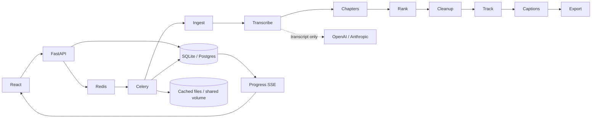

# ClipX

An open-source, local-first studio for turning long speech videos into captioned
vertical clips. Python/FastAPI/Celery workers, React/TypeScript/Vite/Tailwind UI,
FFmpeg rendering, local word-level Whisper and optional transcript-only LLM analysis.

## Quick start

```sh
cp .env.example .env
docker compose up --build
```

Open http://localhost:5173. API docs: http://localhost:8000/docs.
The first local transcription downloads the configured Whisper model. CPU processing
can take several minutes. Data, models, transcripts and exports persist in the `clipx-data` Docker volume (CLI runs use `./data`).
Redis and backend services are private to the Docker network; exposed HTTP ports
bind to localhost. This is a trusted single-user application.

## CLI

```sh
python3.11 -m venv .venv
. .venv/bin/activate
pip install -e '.[test]'
# Install FFmpeg + ffprobe on your operating system.
clipx /path/to/video.mp4 --count 5 --min-length 15 --max-length 60
clipx 'https://www.youtube.com/watch?v=VIDEO_ID' --provider openai
clipx --resume PROJECT_UUID
pytest
```

Use `--provider anthropic` for Anthropic analysis. Local mode makes no paid API calls;
it uses sentence-based heuristic selection, and its scores are labelled accordingly.
Heuristic scores and model scores are editorial estimates, not predictions of views.
Local ASR works across supported Whisper languages; automatic detection is default.
The OpenAI audio fallback is explicitly selected per project and sends audio externally;
analysis sends only transcript text. API transcription currently limits audio to 24MB.

## Configuration

See `.env.example`. Important values: `OPENAI_API_KEY`, `ANTHROPIC_API_KEY`,
`OPENAI_MODEL`, `ANTHROPIC_MODEL`, `WHISPER_MODEL`, `WHISPER_DEVICE`,
`WHISPER_COMPUTE`, `DATABASE_URL`, `REDIS_URL`, `CLIPX_DATA`, `FFMPEG_BIN`,
`FFPROBE_BIN`. SQLite is default; a PostgreSQL URL can use `postgresql+psycopg://`.
Cost estimates use configurable rates, duration and approximate tokens; they are
budget estimates rather than live billing quotes. Set provider rates yourself.

## Architecture



Every stage has its own retryable task and an atomic JSON checkpoint. Resume skips
successful stages. Audio hashes and model/language settings key transcript caches.
A single edit decision list drives video cuts, audio cuts and caption timing.
Clip edits create versioned renders and preserve original exports. Download bundles
include MP4, thumbnail and SRT files.

## Scope and limitations

- Smoothed tracking follows a stable visible face; it does not identify the active
  speaker. Pyannote diarization and multi-speaker identity matching are not enabled.
- Split layout keeps the whole source above a cropped face region; best with
  presenter footage. Inspect composition in the editor before exporting.
- Five ASS caption presets support Unicode; install fonts that cover your language.
  Emoji rendering depends on libass and font support.
- Publishing hooks are feature-flagged and disabled by default; no OAuth uploader
  is provided. Optional intro/outro videos (with audio, up to 15 seconds) and caption emoji are supported; arbitrary font uploads are not included.
- Remote ingest accepts HTTPS YouTube, Vimeo and Twitch URLs. Download availability
  depends on the platform and yt-dlp. Live streams are outside the MVP scope.
- No multi-user authentication, quota manager or public internet deployment hardening.

## Research, credits and rights

Research and reuse decisions: [docs/ARCHITECTURE.md](docs/ARCHITECTURE.md).
Exact revisions and license snapshots: [research/manifest.json](research/manifest.json).
Validation evidence: [docs/VALIDATION.md](docs/VALIDATION.md).

Thanks to [ClipForge / Cutawan](https://github.com/JeremySNR/clip-forge),
[ClipsAI](https://github.com/ClipsAI/clipsai), [ClipsAI docs](https://github.com/ClipsAI/docs),
[ClipsAI editor](https://github.com/ClipsAI/editor),
[ClipsAI video-editor](https://github.com/ClipsAI/video-editor),
[ClippedAI](https://github.com/Shaarav4795/ClippedAI),
[autoclip](https://github.com/zhouxiaoka/autoclip),
[autoclipper](https://github.com/VadlapatiKarthik/autoclipper),
[clipforge-ai](https://github.com/rafapecino/clipforge-ai),
[long-video-to-shorts](https://github.com/joe-jns/long-video-to-shorts), and
[ai-clipping-comfyui](https://github.com/Anil-matcha/ai-clipping-comfyui).
No source code or assets were copied from these references. Reference checkouts
are ignored and excluded from the application image. ClippedAI's noncommercial
license and absent licenses on other references are documented explicitly.

ClipX code is MIT. FFmpeg, models, fonts and installed libraries retain their own
licenses. **You must have rights to every video, recording, logo and other asset you
process.** Obtain any permissions required for redistribution and publication.

## Frontend development

```sh
cd frontend
pnpm install
pnpm build
cd ..
# Requires Python dependencies and FFmpeg on PATH.
sh scripts/dev.sh
```

The development script enables `CLIPX_LOCAL_JOBS=1`, a single-threaded local
adapter for machines without Redis. Production Docker always uses Celery + Redis.
On the Codex workstation used for this build, `source scripts/local-env.sh` sets
paths to bundled runtimes and the downloaded local FFprobe binary before running
the CLI or development script. That helper is optional and workstation-specific.

Generated validation media/metadata and the workstation-specific runtime helper are kept locally and excluded from the public repository. See `docs/VALIDATION.md` for the verification record.
