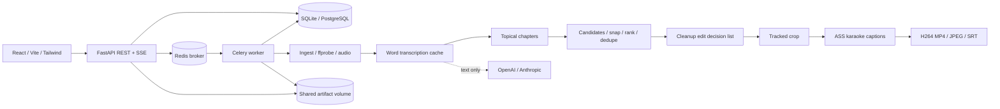

# ClipX architecture and delivery plan

## Step 0 — research completed before implementation

All eleven repositories were shallow-cloned into ignored `research/references/`.
Exact revisions and root license texts are recorded in `research/manifest.json`.

| Reference | Verified license | Study and decision |
|---|---|---|
| JeremySNR/clip-forge (now Cutawan) | MIT | Electron/TypeScript pipeline; studied highlights.ts structured schema, sentence timestamps, hook/build/payoff scoring, captions.ts per-word ASS events and font metrics, reframe.ts shared in-flight analysis and preservation of manual edits. Rewrite in Python; reuse architectural ideas, no source. |
| ClipsAI/clipsai | MIT | TextTiling sentence embeddings for segmentation, WhisperX transcription and resizer.py FaceNet/MediaPipe speaker segments. Rewrite lightweight face tracking; avoid mandatory Torch/Pyannote stack. |
| ClipsAI/docs | No root license found | API documentation reference only; no copied text or code. |
| ClipsAI/editor + video-editor | MIT | Studied resizer context, crop coordinate normalization and pointer-driven editing. Rewrite React editor; avoid timing drift by rendering from server timeline. |
| Shaarav4795/ClippedAI | CC BY-NC 4.0 | Studied script stages, transcript caching and title generation. No code, fonts or prompts reused because of noncommercial restriction. |
| zhouxiaoka/autoclip | MIT | Found through supplied alternatives page; studied subtitle-first segmentation/scoring pipeline, progress snapshots, checkpointing and output branding. Rewrite tasks and persistence. |
| VadlapatiKarthik/autoclipper | No root license found | Exact FastAPI/Celery/React example on supplied topic page; reference only, no copied code. |
| rafapecino/clipforge-ai | MIT | Studied hysteresis, missing-face hold, smoothing and speed limits; independently implement bounded smoothing. |
| joe-jns/long-video-to-shorts | MIT | Local CPU workflow, caption safe zones, screen-content branch; independently implement presets. |
| Anil-matcha/ai-clipping-comfyui | MIT | Ranked top-N, dedupe and coordinate-only API concepts; avoid managed-video API so raw video stays local. |

Reuse existing packages (FastAPI, Celery, SQLAlchemy, FFmpeg, faster-whisper,
OpenCV and yt-dlp), independently implement application code, captions, prompts,
scoring, editing and UI. ClipX source is MIT. FFmpeg builds and models retain
upstream terms; reference checkouts are excluded from distributions.

## Assumptions

- Single-user trusted local installation; bind Docker ports to loopback. Authentication
  and multi-tenant isolation are future work, not implied by this MVP.
- CPU int8 transcription by default, automatic language detection, downloadable model.
- OpenAI/Anthropic analysis is opt-in via environment; without a key use explicitly
  labelled local sentence selection (heuristic scores, not AI predictions).
- OpenAI fallback uploads audio only when explicitly configured. LLMs receive transcript text only.
- Diarization/active-speaker identity is optional future work; face tracking follows
  a stable primary visible face and does not claim audio-speaker identification.
- Publishing is a disabled extension hook; no automatic external posting.
- Real sample validation uses a freely licensed speech video; record source and license.
- Python 3.11 in Docker. Local bundled Python 3.12 may be used for verification.

## Data flow

Projects contain validated processing options; jobs persist stage, progress and errors;
clips contain source boundaries, score breakdown and edit settings. Each pipeline
stage is a separate named retryable Celery task. Stage JSON files are atomic
checkpoints; retry skips completed stages. Shared stage functions also power a
synchronous CLI. Transcript cache keys include audio hash, engine, model and language.
Render cache keys include clip edits and brand settings. Edits invalidate only render
artifacts, leaving transcription/analysis intact. Cleanup uses one edit decision list
for audio, video and rebased caption timestamps.

## Delivery gates

1. This plan and license/reuse report.
2. CLI, unit tests and a real speech sample → exported captioned clip and evidence.
3. REST, persisted jobs, Celery/Redis, SSE → process that sample through API.
4. Responsive upload/progress/results/download UI → show sample project in preview.
5. Trim/transcript editor, custom clips, brand kit and bulk export → rerender sample.

After each gate, present evidence before proceeding. Credentials, model downloads,
Docker daemon availability and optional speaker diarization are reported honestly.
